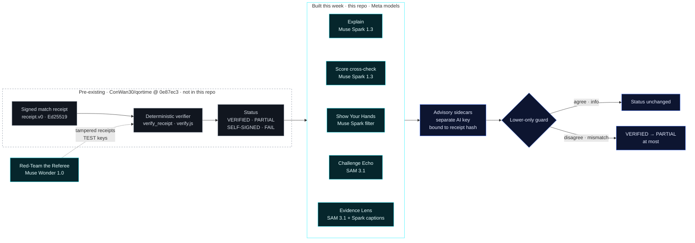

<picture>
  <source media="(prefers-color-scheme: dark)" srcset="docs/readme/hero-dark.svg">
  <source media="(prefers-color-scheme: light)" srcset="docs/readme/hero-light.svg">
  
</picture>

# QorTime AI

**Meta models explain and stress-test a video-game referee's result. They never decide it.**

QorTime is video-game integrity verification: anti-cheat plus verified skill for console head-to-head matches, with a
signed match receipt anyone can check. A deterministic referee checks that signed, hash-chained receipt and returns
`VERIFIED`, `PARTIAL`, `SELF-SIGNED` or `FAIL`. **This repo is the AI layer built on top of it during the hackathon**:
Muse Spark explains the result in plain English and re-reads every locked score, Muse Wonder attacks the verifier,
SAM 3.1 shows what the referee saw. The AI never decides a verdict. Its signals can only lower `VERIFIED` to `PARTIAL`,
never raise a status, never fail a match. QorTime is not a coach and gives no play advice.

[](#quick-start)
[](#quick-start)
[](#for-judges-verify-in-2-minutes)
[](LICENSE)
<br>
[](#where-meta-ai-is-used)
[](#built-this-week-vs-pre-existing)
[](https://qortime.com/)
[](https://x.com/QorTimeHQ)

**Meta Global AI Developer Hackathon (Cerebral Valley), Indie Developer track. Solo build by Contravious Battle.**
This repo holds **only work built during the event (Mon Oct 26 – Wed Nov 4, 2026)**. QorTime's pre-existing code is
kept out; it is fetched at a pinned pre-event commit when you run or test this repo
([what's pre-existing](#built-this-week-vs-pre-existing)).

> **Demo video (2:58):** `[DEMO VIDEO LINK — PLACEHOLDER: YouTube not uploaded yet]`. It opens with one line on what
> was pre-existing and what was built this week.
>
> **Judges: verify it in 2 minutes** → [For judges](#for-judges-verify-in-2-minutes) · Live VERIFIED match:
> [170123](https://qortime.com/matches/170123/) · [open it in the verifier](https://qortime.com/verify/?receipt=https%3A%2F%2Fqortime.com%2Fmatches%2F170123%2Freceipt.json&referee=b283cffb9279f2f90859268c64ef21861ef7e5d9fc773bdb8061af0e80624889)

Not affiliated with Meta, EA, the NFL, Sony or Activision. Madden NFL is a trademark of its owner.

<table>
<tr>
<td width="33%" valign="top">

**Explain** · Muse Spark 1.3

A signed plain-English explanation of the referee's result. A deterministic guardrail drops any text that misstates
the status or overclaims. Fail-closed.

</td>
<td width="33%" valign="top">

**Attack** · Muse Wonder 1.0

Red-Team the Referee: 26 Muse-written tampering attacks against the unmodified verifier.
**Outside attacker: 25 attacks · 0 accepted.**

</td>
<td width="33%" valign="top">

**See** · SAM 3.1

Evidence Lens tracks the scorebug from the referee's own OCR region. Challenge Echo checks every logged D-pad press
shows up on the pause menu. Info only.

</td>
</tr>
</table>

## Contents
[For judges](#for-judges-verify-in-2-minutes) ·
[Where Meta AI is used](#where-meta-ai-is-used) ·
[How it works](#how-it-works) ·
[Built this week vs pre-existing](#built-this-week-vs-pre-existing) ·
[Evidence Lens](#what-the-referee-saw-sam-31-evidence-lens--visualization-only) ·
[Challenge Echo](#challenge-echo-sam-31--info-only-lower-only) ·
[Red-Team the Referee](#red-team-the-referee) ·
[Quick start](#quick-start) ·
[Repo layout](#repo-layout) ·
[Models, services and open-source](#models-services-and-open-source-used) ·
[Honesty rules and limits](#honesty-rules-and-limits) ·
[License and credits](#license-and-credits)

## For judges: verify in 2 minutes

| # | Check | How | Expected |
|---|---|---|---|
| 1 | **Real match, no install** | Open the public verifier on the pre-existing VERIFIED match 170123 (signed Oct 23 2026): [qortime.com/verify/?receipt=…170123…](https://qortime.com/verify/?receipt=https%3A%2F%2Fqortime.com%2Fmatches%2F170123%2Freceipt.json&referee=b283cffb9279f2f90859268c64ef21861ef7e5d9fc773bdb8061af0e80624889) | Gold **VERIFIED** (away 10 – home 0), then the event-built panels: signed Muse Spark explanation, "Muse Spark agrees with 2 of 2 checked locked scores", Show Your Hands. The verifier and match page are pre-existing; the panels are this repo. |
| 2 | **Offline, from this repo** (no API key, ~2 min) | Run the first block in [Quick start](#quick-start), then `node web/demo-170123.mjs` | Output below |
| 3 | **Red team** | `python -m qortime_ai.redteam` | `Outside attacker: 25 attacks · 0 accepted` (offline, cached Muse Wonder output) |
| 4 | **Evidence Lens** | Open [`examples/170123/seen/hl01-q4-a9-h0.seen.mp4`](examples/170123/seen/hl01-q4-a9-h0.seen.mp4), or `web/demo.html` (bottom panel) via the local server | Overlay labelled "SAM 3.1 · visualization, not a referee input" |
| 5 | **AI can't decide** | `pytest -q tests/test_ai_ruling_signing.py tests/test_score_crosscheck.py` | Passes: deleting or tampering with the AI sidecars never changes the verdict; disagreement only lowers VERIFIED → PARTIAL |

Expected output of step 2 (abridged):
```text
verdict (verify.js, deterministic): VERIFIED   referee key auto-pinned: yes (delegation)
after lower-only advisory signals:  VERIFIED (unchanged)
Muse Spark score cross-check:       "Muse Spark agrees with 2 of 2 checked locked scores"
Show Your Hands:                    "No clip could be aligned to the inputs: nothing scored, no penalty."

Muse Spark explanation (advisory, signed by the AI advisory key, never a referee key):
STATUS VERIFIED
...
Not proven: who was holding the controller, that laptop countersignatures were made live, ...
```

## Where Meta AI is used

All four models are called through the Meta Model API. The verdict always comes from the pre-existing deterministic
verifier; every model output lands in a separate sidecar next to the receipt.

| Meta model | What it does | Where in code | Effect on the verdict |
|---|---|---|---|
| **Muse Spark 1.3** | Writes the plain-English explanation of the referee's result. A deterministic guardrail rejects any text that misstates the status or makes banned claims; the result is signed with a separate AI advisory key | [`qortime_ai/ai_ruling/muse.py`](qortime_ai/ai_ruling/muse.py), [`explainer.py`](qortime_ai/ai_ruling/explainer.py), [`guardrail.py`](qortime_ai/ai_ruling/guardrail.py) | **None.** Fail-closed: no key, error or guardrail hit = no explanation |
| **Muse Spark 1.3** | Second, independent reader of the scorebug at every locked score. On 170123: 2 of 2 checked locked scores agree (third: unsure → unchecked), ~$0.009 for 6 reads | [`qortime_ai/ai_ruling/score_crosscheck.py`](qortime_ai/ai_ruling/score_crosscheck.py) | **Lower only.** Agree = no change; disagree = VERIFIED → PARTIAL; unsure/unavailable = "Muse unchecked", no penalty |
| **Muse Spark 1.3** | Filters Show Your Hands play-start candidates | [`qortime_ai/hands/muse_context.py`](qortime_ai/hands/muse_context.py) | **Remove-only**; Show Your Hands is capped at PARTIAL |
| **Muse Spark 1.3** | Cited captions (Evidence Lens) and red-team explanations: every sentence must cite a field, checked by code and a banned-word filter | [`qortime_ai/seen/build.py`](qortime_ai/seen/build.py), [`qortime_ai/redteam/generate.py`](qortime_ai/redteam/generate.py) | **None** |
| **SAM 3.1** | Video-tracks the scorebug and players for the "What the referee saw" Evidence Lens | [`qortime_ai/seen/sam_video.py`](qortime_ai/seen/sam_video.py) | **None** (visualization, not a referee input) |
| **SAM 3.1** | Tracks the pause-menu highlight for Challenge Echo | [`qortime_ai/echo/video.py`](qortime_ai/echo/video.py) | **Info only**; a mismatch can at most lower VERIFIED → PARTIAL |
| **SAM 3.1** | Boxes the scorebug for viewers | [`qortime_ai/ai_ruling/sam_scorebug.py`](qortime_ai/ai_ruling/sam_scorebug.py) | **None** (info only; never a status signal) |
| **Muse Wonder 1.0** | Red-team attacker: proposes receipt-tampering attacks as structured JSON mutations | [`qortime_ai/redteam/generate.py`](qortime_ai/redteam/generate.py) (one live run, cached in [`fixtures/wonder_attacks.json`](qortime_ai/redteam/fixtures/wonder_attacks.json)) | **None.** Attacks the verifier; never edits it |
| **Muse Voice Transcribe 1.0** | Event-stream ASR of the demo narration; each partial's `audioProcessedMs` times the burned-in captions | [`demo_pipeline/captions/transcribe_stream.py`](demo_pipeline/captions/transcribe_stream.py), [`make_srt.py`](demo_pipeline/captions/make_srt.py) (reproduces `data/vo-v6-captions.srt` byte-for-byte) | n/a (video only) |

Keys come only from the environment (`META_API_KEY`); nothing in this repo contains a key. No other Meta model
(e.g. Muse Image) is used. Model IDs and endpoints: [Models, services and open-source](#models-services-and-open-source-used).

## How it works



What the AI may do to a status:

| Verifier status | After AI signals | Why |
|---|---|---|
| `VERIFIED` | `VERIFIED` or `PARTIAL` | A Muse Spark score disagreement, a Show Your Hands flag or a Challenge Echo mismatch can lower it, never further |
| `PARTIAL` · `SELF-SIGNED` · `FAIL` | unchanged | The AI never raises a status and never fails a match |
| any | unchanged if the sidecars are deleted or tampered with | Sidecars are checked (signature, allowlist, receipt binding); invalid = ignored. Tests check this |

On match pages and in the Evidence Lens, **gold is used only when the pre-existing verifier returns VERIFIED**.

## Built this week vs pre-existing

### Pre-existing (not in this repo)
Built before kickoff (everything at [`ConWan30/qortime@0e87ec3`](https://github.com/ConWan30/qortime/commit/0e87ec3),
Sun Oct 25 2026, and earlier), plus the whole capture client:
- [ConWan30/qortime](https://github.com/ConWan30/qortime): receipt format `schema/receipt.v0.json` (frozen), Ed25519
  signing over RFC 8785 canonical JSON, **the deterministic verifier and referee this repo explains**
  (`qor_receipt/receipt.py`, `verify/verify.js`), the referee service and official post-hoc review, trusted-referee
  list and revocations, transparency log, the website and match pages (including the public VERIFIED match 170123,
  signed Oct 23 2026).
- [ConWan30/qorcap](https://github.com/ConWan30/qorcap): the Windows capture client (capture-card video hash chain,
  DualSense USB log, pause challenges). No Meta model calls.
- **Brand assets:** the QorTime name, clock mark, colors and hero-banner style are pre-existing (from ConWan30/qortime).
  The hero SVGs in [`docs/readme/`](docs/readme/) were redrawn for this repo in that style.

This repo uses that code only as a **pinned dependency** (`pyproject.toml` → `qor-receipt @ git+…@0e87ec3`) and a
**git-ignored checkout** (`scripts/fetch_upstream.sh` → `upstream/qortime/`, same commit). Nothing from it is committed
here. The only pre-existing data used is the public receipt of match 170123, fetched from that checkout into
`examples/170123/` (git-ignored).

### Built Oct 26 – Nov 4, 2026 (in this repo)
| What | Path | Meta model | Effect on the verdict |
|---|---|---|---|
| Receipt explainer: verifier results → plain-English explanation, fail-closed, deterministic guardrail (exact status, no device-proof overclaims, no coaching, no identity claims) | `qortime_ai/ai_ruling/explainer.py`, `guardrail.py`, `muse.py`, `__main__.py` | Muse Spark 1.3 | none |
| Separate AI **advisory** signing key (never a referee key) + signed sidecar bound to the receipt hash | `qortime_ai/ai_ruling/signing.py`, `advisory_keys.json`, `web/ai_advisory_keys.inc.js` | — | none |
| Score cross-check: Muse Spark is a second reader of every locked score | `qortime_ai/ai_ruling/score_crosscheck.py`, `web/score-crosscheck-view.js`, `web/lower-only.js` | Muse Spark 1.3 | lower only (VERIFIED → PARTIAL) |
| Scorebug locator for viewers | `qortime_ai/ai_ruling/sam_scorebug.py` | SAM 3.1 | none (info only) |
| Show Your Hands: verified-input overlay + press-to-pixel check; Muse play-start filter can only remove candidates | `qortime_ai/hands/`, `web/hands-view.js` | Muse Spark 1.3 | lower only, capped at PARTIAL |
| Automatic advisory job run by the referee after the verdict is final (caps, kill switch, retries) | `qortime_ai/ai_ruling/auto.py` | Muse Spark 1.3 | none (never delays or changes it) |
| Advisory fetch from the referee + verifier auto-pin of trusted referee keys | `web/advisory-fetch.js`, `web/auto-pin.js`, `web/AUTO_PIN.md` | — | none |
| Browser panels for the signed advisory files | `web/*-view.js`, `web/advisory-panels.css`, `web/demo.html`, `web/demo-170123.mjs` | — | display only |
| Demo-video captions timed by ASR | `demo_pipeline/captions/` | Muse Voice Transcribe 1.0 | n/a (video only) |
| Red-Team the Referee: Muse Wonder writes 26 receipt-tampering attacks (cached); the pre-existing verifier judges them against fresh TEST keys, as an outside attacker and as an insider holding the TEST signing keys; Muse Spark explanations must cite a field in every sentence, checked by code + banned-word filter | `qortime_ai/redteam/`, `examples/redteam/` | Muse Wonder 1.0, Muse Spark 1.3 | none (attacks the verifier; never edits it) |
| Signed advisory files for match 170123 | `examples/170123/{ai_ruling,score_crosscheck,hands}.json` | Muse Spark 1.3 | — |
| "What the referee saw" Evidence Lens: SAM 3.1 video-tracks the scorebug from the referee's own OCR region, motion split players / HUD / rest, `seen.v0` sidecar, cited Muse Spark captions, overlay render + web panel | `qortime_ai/seen/`, `web/seen-view.js`, `examples/170123/seen.json`, `examples/170123/seen/` | SAM 3.1, Muse Spark 1.3 | none (visualization, not a referee input) |
| Challenge Echo: SAM 3.1 tracks the pause-menu highlight; each logged D-pad press must be echoed on screen (latency, directions matched, menu after OPTIONS), `echo.sidecar.json` | `qortime_ai/echo/`, `web/echo-view.js`, `examples/practice-echo/` | SAM 3.1 | info only; a mismatch can at most lower VERIFIED → PARTIAL |
| README, docs and hero banners | `README.md`, `docs/`, sub-folder READMEs | — | — |

File-by-file origin (qortime PR numbers): [`PROVENANCE.md`](PROVENANCE.md).

## What the referee saw (SAM 3.1 Evidence Lens) — visualization only
**Built Oct 27 2026, in the event window.** `qortime_ai/seen/` chains the deterministic referee into Meta SAM 3.1 video
tracking on QorCap's three **public** match-170123 highlight clips (12 s each).

- **Box prompt = the referee's own scorebug OCR region.** Scorebug in place on 359/359 and 360/360 frames (hl00, hl01),
  anchor moves ≤ 2 px. hl02: in place on 249/360 frames until 8.3 s, then the game swaps in a "scoring drive" graphic
  and SAM's object leaves the region — shown, not judged.
- **Concept prompt "football player"** only splits the referee's own frame-difference energy into players / HUD / rest
  of screen. Aggregate percentages only, never per-player data, routes, speeds or play quality.
- **`examples/170123/seen.json` (`seen.v0`)** binds everything to the receipt hash. No per-frame masks, no status
  field; `receipt.v0` is unchanged. Muse Spark writes one cited caption per segment.
- **Render:** a holographic lens appears only inside receipt event windows. Aqua by default; gold only for a score lock
  when the pre-existing verifier returns VERIFIED. Corner label: "SAM 3.1 · visualization, not a referee input".

Cost: SAM 3.1 6 × 360 frames ≈ $0.43; Spark captions ≈ $0.05. Full write-up (prompts, numbers, render, CLI):
[`docs/EVIDENCE_LENS.md`](docs/EVIDENCE_LENS.md).

## Challenge Echo (SAM 3.1) — info only, lower-only
**Built Oct 27 2026, during the hackathon week.** During a pause challenge the player presses OPTIONS, enters the D-pad
pattern on the pause menu, then selects Resume. `qortime_ai/echo/` checks that the **video follows the input log**:
every logged D-pad press must be followed by the matching move of the pause-menu highlight.

- **SAM 3.1** tracks the pause-menu highlight box (only the menu-list column, nothing player-identifying). A
  deterministic tracker is the fallback and a cross-check: SAM and the fallback agree on 98–100 % of frames in 9 of 10
  practice windows.
- **Deterministic code** does the press edges, "menu appeared" and the matching. Per press: press-to-pixel latency.
  Per window: directions matched N of M, jitter, menu after OPTIONS.
- **Effect:** `echo.sidecar.json` (`qortime.echo.v0`, integers only; `receipt.v0.json` untouched). `consistent` /
  `partial` / `unscorable` add a note only; `mismatch` can suggest VERIFIED → PARTIAL and nothing else. The live
  referee and its challenge check are not changed.

Practice run (10 pause challenges from one practice game; video and inputs kept private, aggregates in
[`examples/practice-echo/echo.sidecar.json`](examples/practice-echo/echo.sidecar.json)): **8 consistent, 2 partial,
0 mismatch.** Median press-to-pixel per window 0.94–1.70 s, jitter inside a window ≤ 44 ms. Cost ≈ $0.31.
Full write-up (matching rules, clock calibration, the two partial windows, CLI): [`docs/CHALLENGE_ECHO.md`](docs/CHALLENGE_ECHO.md).

## Red-Team the Referee
`python -m qortime_ai.redteam` →

| Attacker | Attacks | Accepted | What it shows |
|---|---|---|---|
| **Outside attacker** (no signing keys) | 25 | **0** | Every tampered receipt is rejected by the unmodified pre-existing verifier |
| **Insider with signing keys** (re-signs with the TEST referee + player keys) | 25 | 12 | Inner checks still stop 13. The 12 accepted are labelled **needs key protection (out of scope for the verifier)**: 6 plain re-signed score edits, 1 benign challenge reorder, 5 reported inner-check gaps in the pre-existing verifier, left unchanged |

Plus 1 pure replay that is byte-identical to an honest receipt, reported separately. Muse Wonder 1.0 proposed 26 attacks
once (forged and re-signed signatures, score and winner edits, splices, dropped and reordered checkpoints, timestamp
shifts, trust-tier upgrades, signal laundering, type confusion, pin tricks); the output is cached so the run is offline
and deterministic. Attacks run on a synthetic match with **freshly generated in-memory TEST keys** — never a real key,
never the live referee, no real match data. Muse Spark then explains results with a field citation in every sentence.
Full write-up: [`docs/RED_TEAM.md`](docs/RED_TEAM.md) · per-attack table: [`examples/redteam/summary.md`](examples/redteam/summary.md).

## Quick start
Requires Python ≥ 3.10, Node ≥ 20, git. **No API key needed for tests or the demo.**
```bash
./scripts/fetch_upstream.sh            # pre-existing qortime @ 0e87ec3 -> upstream/ (git-ignored) + 170123 receipt
python -m venv .venv && . .venv/bin/activate
pip install -e '.[dev]'                # installs the pinned pre-existing qor-receipt library as a dependency
pytest -q                              # 216 passed, 5 skipped (referee-hook integration tests live upstream)
npm test                               # 7 browser-module test files, 153 checks
node web/demo-170123.mjs               # offline: verdict from verify.js, then the signed Muse files, lower-only
python -m http.server 8000             # from the repo root; then open http://localhost:8000/web/demo.html
```
Counts re-checked Tue Oct 27 2026 (with Challenge Echo). Optional overlay render needs `pip install -e '.[seen]'` and
ffmpeg on PATH. `demo_pipeline/captions/transcribe_stream.py` needs `requests` (`pip install -e '.[captions]'`; also in `[dev]`).

Live Muse Spark explanation (needs a Meta Model API key):
```bash
META_API_KEY=... python -m qortime_ai.ai_ruling examples/170123/receipt.json --no-write \
  --pub b283cffb9279f2f90859268c64ef21861ef7e5d9fc773bdb8061af0e80624889
```
Other paid refresh steps: `python -m qortime_ai.seen.fetch` (SAM; outputs cached outside the repo) and `--spark`;
`META_API_KEY=... python -m qortime_ai.redteam --generate` (≈ $0.10). The production integration (the referee's
background hook and the verifier page at https://qortime.com/verify/) is a small set of edits to pre-existing qortime
files and stays in that repo (see [`PROVENANCE.md`](PROVENANCE.md)).

## Repo layout
```
qortime_ai/ai_ruling/   Muse Spark explainer, guardrail, advisory signing, score cross-check, SAM scorebug, auto job
qortime_ai/hands/       Show Your Hands: input integrity, overlay track, press-to-pixel, Muse play-start filter
qortime_ai/redteam/     Red-Team the Referee: Muse Wonder attacks, harness, cited Spark explanations, wording filter
qortime_ai/seen/        "What the referee saw" Evidence Lens: SAM 3.1 video tracking, captions, overlay render
qortime_ai/echo/        Challenge Echo: SAM 3.1 pause-menu highlight track vs logged D-pad presses
web/                    browser panels, lower-only guard, auto-pin, advisory fetch, demo page, node tests
tests/                  pytest suite (runs against the pinned pre-existing qortime checkout)
examples/               signed advisory files for 170123, Evidence Lens samples, red-team report, Echo aggregates
demo_pipeline/captions/ Muse Voice Transcribe caption timing for the demo video
docs/                   feature write-ups and README hero banners
scripts/                fetch_upstream.sh (pre-existing code, git-ignored, pinned)
PROVENANCE.md           file-by-file origin, PR numbers, event-window dates
```

## Models, services and open-source used
**Meta models** (all called through the Meta Model API, `https://api.meta.ai/v1`, key from `META_API_KEY`):

| Model | Called from | Endpoint |
|---|---|---|
| Muse Spark 1.3 (`muse-spark-1.3`) | `qortime_ai/ai_ruling/muse.py`, `score_crosscheck.py`, `hands/muse_context.py`, `redteam/generate.py`, `seen/build.py` | `/chat/completions` |
| SAM 3.1 (`sam-3.1`) | `qortime_ai/ai_ruling/sam_scorebug.py`, `qortime_ai/seen/sam_video.py`, `qortime_ai/echo/video.py` | `/responses` |
| Muse Wonder 1.0 (`muse-wonder-1.0`) | `qortime_ai/redteam/generate.py` (one live run; output cached in `fixtures/wonder_attacks.json`) | `/chat/completions` |
| Muse Voice Transcribe 1.0 (`muse-voice-transcribe-1.0`) | `demo_pipeline/captions/transcribe_stream.py` | `/asr/transcribe` |

No other Meta model (e.g. Muse Image) is used.

**Open-source used by this code:** `cryptography`, `numpy`, `opencv-python-headless`, `pillow`, `meta-sam-parser`
(SAM output parsing), `requests` (caption script), and for tests `pytest`, `fastapi`, `httpx`; FFmpeg (frame extraction,
overlay encode, caption silence detection); Node.js ≥ 20 (browser-module tests); DejaVu fonts (overlay text). Pre-existing,
not in this repo: `qor-receipt` from [ConWan30/qortime@0e87ec3](https://github.com/ConWan30/qortime/commit/0e87ec3).

**Used only to make the demo video (not in this repo, never part of the referee):**
- xAI text-to-speech, voice "Rex": narration (AI voice)
- Grok Imagine: AI-generated cold open and phone callback, labelled DRAMATIZATION on screen (the phone screen shows the
  real qortime.com verifier output for match 170123, composited)
- Remotion: animated Meta-models / roadmap / "what this doesn't prove" section; headless Chrome: card stills; FFmpeg + x264: edit and encode
- Sound effects and music: original, synthesized with NumPy for this video. (ElevenLabs sound effects were used only in
  early cuts and were all replaced; none are in the final video.)
- Captions: timed with Muse Voice Transcribe (`demo_pipeline/captions/`; the committed data reproduces the v6 narration
  captions — the final cut's extra beats were timed the same way)

## Honesty rules and limits
- **The verdict comes only from the deterministic verifier.** AI output lives in separate signed sidecars; deleting or
  tampering with them never changes the verdict (tests check this).
- **AI explains, it never decides.** Advisory signals can only lower VERIFIED → PARTIAL; they never raise a status or fail a match.
- **The receipt format is frozen;** new data goes in sidecars.
- **No device-proof overclaims** (banned list in [`qortime_ai/redteam/wording.py`](qortime_ai/redteam/wording.py));
  device status is at most "TPM claimed (unverified)".
- **QorTime does not prove who held the controller and does not catch collusion.**
- **Not a coach.** Anti-cheat and verified skill only; prompts forbid play advice and the guardrail drops it.
- **Measured limits, stated plainly:** on 170123, Show Your Hands press-to-pixel is *not scored* (clips could not be
  aligned); SAM's still-frame scorebug locator found the scorebug on 4 of 6 frames, so it is never a status signal; the
  insider red-team pass found 5 inner-check gaps in the pre-existing verifier, reported and left unchanged.
- **No secrets, raw match footage, raw controller logs, gamertags, OCR weights or held-out game data in this repo.**

Per-module detail: [`qortime_ai/ai_ruling/README.md`](qortime_ai/ai_ruling/README.md) ·
[`qortime_ai/hands/README.md`](qortime_ai/hands/README.md) · [`web/AUTO_PIN.md`](web/AUTO_PIN.md) · [`docs/`](docs/README.md).

## Creator & contact

Built by **Contravious Battle**, solo founder, QorTime.

- Email: [qoresence@mail.grokbot.com](mailto:qoresence@mail.grokbot.com) (project inbox)
- LinkedIn: [linkedin.com/in/contravious-battle-b8a25a445](https://www.linkedin.com/in/contravious-battle-b8a25a445)
- X: [@ConWanZo](https://x.com/ConWanZo) (personal) · [@QorTimeHQ](https://x.com/QorTimeHQ) (project)
- GitHub: [ConWan30](https://github.com/ConWan30)

## License and credits

[MIT](LICENSE). Copyright (c) 2026 Contravious Battle (ConWan30).

- **Pre-existing, not in this repo:** the QorTime receipt format, referee and verifier this AI layer explains
  ([ConWan30/qortime@0e87ec3](https://github.com/ConWan30/qortime/commit/0e87ec3)), the QorCap capture client, and the
  QorTime brand (name, clock mark, colors). That code carries its own vendored MIT components (`qor_receipt/_vendor`
  from ConWan30/Qoresence; `verify/vendor/noble-ed25519.js`, Paul Miller). No third-party code is vendored here.
- **Meta models:** Muse Spark 1.3, SAM 3.1, Muse Wonder 1.0, Muse Voice Transcribe 1.0, via the Meta Model API.
- **Hero banner type:** Big Shoulders Display and JetBrains Mono (SIL Open Font License), converted to paths by
  [`docs/readme/make_hero.py`](docs/readme/make_hero.py).

Not affiliated with Meta, EA, the NFL, Sony or Activision. Madden NFL is a trademark of its owner.
