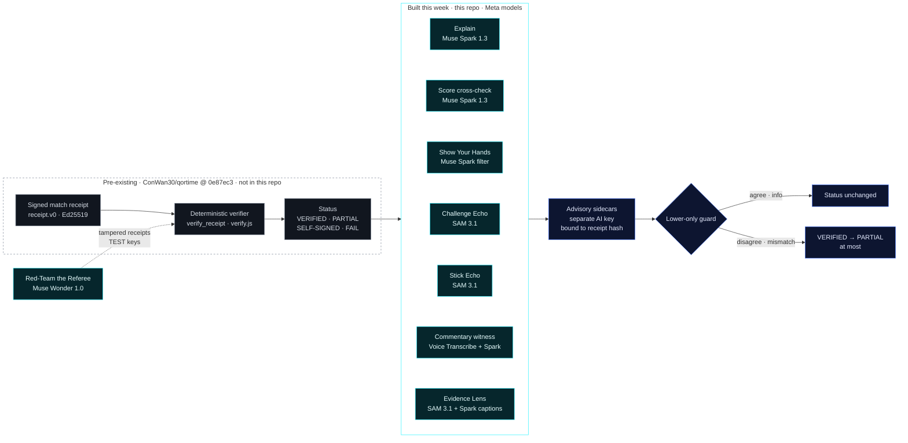

<picture>
  <source media="(prefers-color-scheme: dark)" srcset="docs/readme/hero-dark.svg">
  <source media="(prefers-color-scheme: light)" srcset="docs/readme/hero-light.svg">
  
</picture>

# QorTime AI

**Meta models explain and stress-test a video-game referee's result. They never decide it.**

> **Video (under 3 min):** https://youtu.be/vlGJ1LXxumE<br>
> **Verifier:** [match 170123, referee key pinned](https://qortime.com/verify/?receipt=https%3A%2F%2Fqortime.com%2Fmatches%2F170123%2Freceipt.json&referee=b283cffb9279f2f90859268c64ef21861ef7e5d9fc773bdb8061af0e80624889) (unpinned shows PARTIAL, as expected) · [match 220105 page](https://qortime.com/matches/220105/)<br>
> **Judge check (offline, no API key):** `./scripts/fetch_upstream.sh && pip install -e '.[dev]' && pytest -q && node web/demo-170123.mjs` ([details](#for-judges-verify-in-2-minutes))<br>
> **Meta models used:** Muse Spark 1.3, SAM 3.1, Muse Wonder 1.0, Muse Voice Transcribe 1.0 ([results](#meta-model-results)). They explain and never decide.

Toward anti-cheat and verified skill: integrity checks for console head-to-head results, with a signed receipt anyone
can re-check and its limits stated next to it. A deterministic referee checks that signed, hash-chained receipt and returns
`VERIFIED`, `PARTIAL`, `SELF-SIGNED` or `FAIL`. **This repo is the AI layer built on top of it during the hackathon**:
Muse Spark explains the result in plain English and re-reads every locked score, Muse Wonder attacks the verifier,
SAM 3.1 shows what the referee saw. The AI never decides a verdict. Its signals can only lower `VERIFIED` to `PARTIAL`,
never raise a status, never fail a match. QorTime is not a coach and gives no play advice.

[](#quick-start)
[](#quick-start)
[](#for-judges-verify-in-2-minutes)
[](LICENSE)
<br>
[](#where-meta-ai-is-used)
[](#built-this-week-vs-pre-existing)
[](https://qortime.com/)
[](https://x.com/QorTimeHQ)

**Meta Global AI Developer Hackathon (Cerebral Valley), Indie Developer track. Solo build by Contravious Battle.**
This repo holds **only work built during the event (Mon Oct 26 – Wed Nov 4, 2026)**. QorTime's pre-existing code is
kept out; it is fetched at a pinned pre-event commit when you run or test this repo
([what's pre-existing](#built-this-week-vs-pre-existing)).

> **Demo video (under 3 minutes):** https://youtu.be/vlGJ1LXxumE. It opens with one line on what
> was pre-existing and what was built this week.
>
> **Judges: verify it in 2 minutes** → [For judges](#for-judges-verify-in-2-minutes) · Two matches VERIFIED by the official referee (referee key pinned; unpinned shows PARTIAL):
> [170123](https://qortime.com/matches/170123/) ([verifier](https://qortime.com/verify/?receipt=https%3A%2F%2Fqortime.com%2Fmatches%2F170123%2Freceipt.json&referee=b283cffb9279f2f90859268c64ef21861ef7e5d9fc773bdb8061af0e80624889)) ·
> [220105](https://qortime.com/matches/220105/) (played and verified during the event week)

Not affiliated with Meta, EA, the NFL, Sony or Activision. Madden NFL is a trademark of its owner.

<table>
<tr>
<td width="33%" valign="top">

**Explain** · Muse Spark 1.3

A signed plain-English explanation of the referee's result. A deterministic guardrail drops any text that misstates
the status or overclaims. Fail-closed.

</td>
<td width="33%" valign="top">

**Attack** · Muse Wonder 1.0

Red-Team the Referee: Muse Wonder wrote 26 attacks, 25 tampered receipts plus 1 byte-identical replay (reported
separately), run against the unmodified verifier on a synthetic match with synthetic TEST keys.
**Outside attacker: 0 of 25 accepted · insider holding the TEST keys: 12 of 25 accepted** (labelled "needs key protection").

</td>
<td width="33%" valign="top">

**See** · SAM 3.1

Evidence Lens tracks the scorebug from the referee's own OCR region. Challenge Echo checks every logged D-pad press
shows up on the pause menu. Stick Echo checks the controlled player moves with the logged left stick. Info only.

</td>
</tr>
</table>

**Why this matters.** Today the only way a gamer can show they're good is to perform live, for hours, for whoever happens to be watching, and often almost nobody is. QorTime moves the proof into the match itself. Every verified game produces a signed receipt and a public match page anyone can check, whether ten thousand people watched or nobody did. Where we're headed: a record of verified skill and play time that players build just by playing, which they can share and be ranked on, without having to stream.

## Who benefits
- **Players in competitive head-to-head matches** who want a result both sides can check, instead of a screenshot and an argument.
- **Tournament organizers and ladders** who have to resolve "that's not the real score" disputes and want a signed
  receipt plus a plain-English explanation they can link.
- **Platforms that resolve score disputes** and need a status they can re-check themselves, with the limits stated
  next to it.

This describes who it is built for. It is not a customer or partner list.

## Contents
[Who benefits](#who-benefits) ·
[For judges](#for-judges-verify-in-2-minutes) ·
[Where Meta AI is used](#where-meta-ai-is-used) ·
[Meta model results](#meta-model-results) ·
[How it works](#how-it-works) ·
[Built this week vs pre-existing](#built-this-week-vs-pre-existing) ·
[Evidence Lens](#what-the-referee-saw-sam-31-evidence-lens--visualization-only) ·
[Challenge Echo](#challenge-echo-sam-31--info-only-lower-only) ·
[Stick Echo](#stick-echo-sam-31--info-only-lower-only) ·
[Commentary witness](docs/COMMENTARY_WITNESS.md) ·
[Agent API](docs/AGENT_API.md) ·
[Red-Team the Referee](#red-team-the-referee) ·
[Quick start](#quick-start) ·
[Repo layout](#repo-layout) ·
[Models, services and open-source](#models-services-and-open-source-used) ·
[Honesty rules and limits](#honesty-rules-and-limits) ·
[License and credits](#license-and-credits)

## For judges: verify in 2 minutes

**Two matches, both `VERIFIED` by the official QorTime referee (referee key pinned; unpinned shows PARTIAL)** (`qortime-online-s2`, delegation serial 2 from root
`qortime-v1`). Both are Madden NFL 27 on PS5, recorded with QorCap and reviewed after upload. The referee spot-checked
the video segments, re-read the final, re-checked the three pause challenges, and ran motion and input-integrity
checks. Each match folder also has a signed Muse Spark explanation (`ai_ruling.json`, AI advisory key). It explains
the result and never decides it.

| Match | When | Final (away – home) | Referee | Page | Verify |
|---|---|---|---|---|---|
| **170123** | Oct 23 2026, **before** the event | 10 – 0 | 7 of 7 checks pass · spot-check 166/525 segments · public log entry #1 | [qortime.com/matches/170123](https://qortime.com/matches/170123/) | [open in the verifier](https://qortime.com/verify/?receipt=https%3A%2F%2Fqortime.com%2Fmatches%2F170123%2Freceipt.json&referee=b283cffb9279f2f90859268c64ef21861ef7e5d9fc773bdb8061af0e80624889) |
| **220105** | Oct 27 2026, **during** the event | 7 – 21 | 7 of 7 checks pass · spot-check 270/878 segments · public log entry #4 | [qortime.com/matches/220105](https://qortime.com/matches/220105/) | the page's **Verify it yourself** card: the verifier, plus an in-browser check of the referee's public log |

**Referee log entries without a page.** The referee's public log has 6 entries (seq 0–5). Only seq 1 (170123) and seq 4
(220105) are VERIFIED, and only they have pages. Seq 0 is an earlier PARTIAL submission of 170123. Seq 2, 3 and 5 are PARTIAL
results for two other matches. Each is listed in [`PROVENANCE.md`](PROVENANCE.md#referee-log-entries-without-a-match-page).

What to look for on **220105**, stated as plainly as on the page:
- **The final came through the referee's end-menu fallback.** The referee found no fourth-quarter scorebug in the last
  part of the video, so it read the end-of-game menu and checked it against the last locked score in the signed
  timeline. They matched. The fallback logic is pre-existing referee code (at `0e87ec3`). The end-menu reader it used
  includes an in-window fix: qorcap #116, pinned into the referee by qortime #104 on Oct 26 (see [`PROVENANCE.md`](PROVENANCE.md)).
- **One advisory flag is shown, not hidden:** `alignment_not_above_chance`. QorCap's on-device controller-vs-video
  timing score was 435‰ against 477‰ for chance. It is advisory only. It is not one of the referee's seven checks and
  it does not change the status. Human-likeness was 950‰, which is also advisory.
- **Challenge Echo (SAM 3.1, info only) read all 3 official challenges as consistent** after
  [PR #7](https://github.com/ConWan30/qortime-ai/pull/7). Median press-to-screen was 1637 / 1626 / 1662 ms
  (kickoff / halftime / end). Echo never changes a verdict. The video and inputs stay private, so this run cannot be
  reproduced from this repo.

| # | Check | How | Expected |
|---|---|---|---|
| 1 | **Real match, no install** | Open the 170123 verifier link above, or the **Verify it yourself** card on the 220105 page | Gold **VERIFIED**. On 170123 you also get the event-built panels: signed Muse Spark explanation, "Muse Spark agrees with 2 of 2 checked locked scores", Show Your Hands. The verifier and match pages are pre-existing; the panels are this repo. |
| 2 | **Public log** | `curl https://qortime-referee-production.up.railway.app/v1/log/inclusion/8a3a6d60e498c607fef79e013afab333b760fb7c9e58e16fa9912683c98cb71b` | Entry `seq 4`, submission `1d424dc2836f1a8c`, match `local-20261027-220105`. **Offline equivalent:** `pytest -q tests/test_agent_api.py` re-checks a committed log-inclusion proof (match 170123, seq 1) from [`tests/fixtures/agent_api/`](tests/fixtures/agent_api/) without network |
| 3 | **Offline, from this repo** (no API key, ~2 min) | Run the first block in [Quick start](#quick-start), then `node web/demo-170123.mjs` | Output below |
| 4 | **Red team** | `python -m qortime_ai.redteam` | `Outside attacker: 25 attacks · 0 accepted` and `Insider with signing keys: 25 attacks · 12 accepted`, plus 1 replay reported separately (offline, cached Muse Wonder output, synthetic TEST keys) |
| 5 | **Evidence Lens** | Open [`examples/170123/seen/hl01-q4-a9-h0.seen.mp4`](examples/170123/seen/hl01-q4-a9-h0.seen.mp4), or `web/demo.html` (bottom panel) via the local server | Overlay labelled "SAM 3.1 · visualization, not a referee input" |
| 6 | **AI can't decide** | `pytest -q tests/test_ai_ruling_signing.py tests/test_score_crosscheck.py` | Passes: deleting or tampering with the AI sidecars never changes the verdict; disagreement only lowers VERIFIED → PARTIAL |
| 7 | **Agent verify API** (built Oct 28 2026, this week) | `curl "https://agent-api-production-0e55.up.railway.app/agent/v1/verify?url=https://qortime.com/matches/220105/"` · spec: [`/agent/v1/openapi.json`](https://agent-api-production-0e55.up.railway.app/agent/v1/openapi.json) · MCP: `/agent/mcp` · [`docs/AGENT_API.md`](docs/AGENT_API.md) | `"verified": true`, `"status": "VERIFIED"`, three passing reasons (pinned-key signature, public log entry seq 4, page score = receipt). An agent must only announce or record a result as VERIFIED when `verified` is true. **Offline equivalent:** `pytest -q tests/test_agent_api.py::test_verify_real_receipt_is_true` runs the same API against the 170123 receipt and the fixtures in [`tests/fixtures/agent_api/`](tests/fixtures/agent_api/) |

**Demo video:** see the link at the top of this README. It opens with one line on what was pre-existing and what was
built this week.

Expected output of step 3 (abridged):
```text
verdict (verify.js, deterministic): VERIFIED   referee key auto-pinned: yes (delegation)
after lower-only advisory signals:  VERIFIED (unchanged)
Muse Spark score cross-check:       "Muse Spark agrees with 2 of 2 checked locked scores"
Show Your Hands:                    "No clip could be aligned to the inputs: nothing scored, no penalty."

Muse Spark explanation (advisory, signed by the AI advisory key, never a referee key):
STATUS VERIFIED
...
Not proven: who was holding the controller, that laptop countersignatures were made live, ...
```

## Where Meta AI is used

All four models are called through the Meta Model API. The verdict always comes from the pre-existing deterministic
verifier; every model output lands in a separate sidecar next to the receipt.

| Meta model | What it does | Where in code | Effect on the verdict |
|---|---|---|---|
| **Muse Spark 1.3** | Writes the plain-English explanation of the referee's result. A deterministic guardrail rejects any text that misstates the status or makes banned claims; the result is signed with a separate AI advisory key | [`qortime_ai/ai_ruling/muse.py`](qortime_ai/ai_ruling/muse.py), [`explainer.py`](qortime_ai/ai_ruling/explainer.py), [`guardrail.py`](qortime_ai/ai_ruling/guardrail.py) | **None.** Fail-closed: no key, error or guardrail hit = no explanation |
| **Muse Spark 1.3** | Second, independent reader of the scorebug at every locked score. On 170123: 2 of 2 checked locked scores agree (third: unsure → unchecked), ~$0.009 for 6 reads. Dev bench (not held out): 73/73 visible scores, see [`docs/SCORE_BENCH.md`](docs/SCORE_BENCH.md) | [`qortime_ai/ai_ruling/score_crosscheck.py`](qortime_ai/ai_ruling/score_crosscheck.py) | **Lower only.** Agree = no change; disagree = VERIFIED → PARTIAL; unsure/unavailable = "Muse unchecked", no penalty |
| **Muse Spark 1.3** | Filters Show Your Hands play-start candidates | [`qortime_ai/hands/muse_context.py`](qortime_ai/hands/muse_context.py) | **Remove-only**; Show Your Hands is capped at PARTIAL |
| **Muse Spark 1.3** | Cited captions (Evidence Lens) and red-team explanations: every sentence must cite a field, checked by code and a banned-word filter | [`qortime_ai/seen/build.py`](qortime_ai/seen/build.py), [`qortime_ai/redteam/generate.py`](qortime_ai/redteam/generate.py) | **None** |
| **SAM 3.1** | Video-tracks the scorebug and players for the "What the referee saw" Evidence Lens | [`qortime_ai/seen/sam_video.py`](qortime_ai/seen/sam_video.py) | **None** (visualization, not a referee input) |
| **SAM 3.1** | Tracks the pause-menu highlight for Challenge Echo | [`qortime_ai/echo/video.py`](qortime_ai/echo/video.py) | **Info only**; a mismatch can at most lower VERIFIED → PARTIAL |
| **SAM 3.1** | Tracks the controlled player for Stick Echo (box prompt seeded on the game's controlled-player marker) | [`qortime_ai/stickecho/video.py`](qortime_ai/stickecho/video.py) | **Info only**; a clear disagreement can at most lower VERIFIED → PARTIAL |
| **SAM 3.1** | Boxes the scorebug for viewers | [`qortime_ai/ai_ruling/sam_scorebug.py`](qortime_ai/ai_ruling/sam_scorebug.py) | **None** (info only; never a status signal) |
| **Muse Wonder 1.0** | Red-team attacker: proposes receipt-tampering attacks as structured JSON mutations | [`qortime_ai/redteam/generate.py`](qortime_ai/redteam/generate.py) (one live run, cached in [`fixtures/wonder_attacks.json`](qortime_ai/redteam/fixtures/wonder_attacks.json)) | **None.** Attacks the verifier; never edits it |
| **Muse Voice Transcribe 1.0** + **Muse Spark 1.3** | Commentary witness (built Oct 28 2026): transcribes a recorded match's broadcast commentary, Muse Spark lists the scoring plays the commentators call, code matches them to the referee's locked scores. On 170123's 3 public clips: 3 of 3 agree (dev check on the same clips, after one prompt revision; full-game false-call rate not yet measured). See [`docs/COMMENTARY_WITNESS.md`](docs/COMMENTARY_WITNESS.md) | [`qortime_ai/commentary/`](qortime_ai/commentary/) | **Info only, lower only.** Broadcast agrees = no change; disagrees = VERIFIED → PARTIAL; muted/absent commentary or ASR failure = "broadcast unchecked", no penalty |
| **Muse Voice Transcribe 1.0** | Event-stream ASR of the demo narration; each partial's `audioProcessedMs` times the captions (v6 narration; later cuts were timed from the text-to-speech timestamps) | [`demo_pipeline/captions/transcribe_stream.py`](demo_pipeline/captions/transcribe_stream.py), [`make_srt.py`](demo_pipeline/captions/make_srt.py) (reproduces `data/vo-v6-captions.srt` byte-for-byte) | n/a (video only) |

### Meta model results
Every number below is already stated elsewhere in this README. The source is listed for each. These are small dev checks, not measured accuracy.

| Model | Result | Source |
|---|---|---|
| Muse Spark 1.3 | Score cross-check on 170123: 2 of 2 checked locked scores agree (third: unsure, unchecked). Dev bench, not held out: 73/73 visible scores | [table above](#where-meta-ai-is-used), [`docs/SCORE_BENCH.md`](docs/SCORE_BENCH.md) |
| Muse Wonder 1.0 | 26 attacks (25 tampers + 1 replay). Outside attacker 0 of 25 accepted; insider with the synthetic TEST keys 12 of 25 accepted | [Red-Team the Referee](#red-team-the-referee) |
| SAM 3.1 (Evidence Lens) | Scorebug in place on 359/359 and 360/360 frames (hl00, hl01); hl02 249/360 until a game graphic replaces it | [Evidence Lens](#what-the-referee-saw-sam-31-evidence-lens--visualization-only) |
| SAM 3.1 (Challenge Echo) | Practice game: 8 consistent, 2 partial, 0 mismatch over 10 windows. 220105: all 3 official challenges consistent | [Challenge Echo](#challenge-echo-sam-31--info-only-lower-only), [For judges](#for-judges-verify-in-2-minutes) |
| SAM 3.1 (Stick Echo) | 2 of 3 private practice games clear the bar (z ≥ 3 against every null) | [Stick Echo](#stick-echo-sam-31--info-only-lower-only) |
| SAM 3.1 (scorebug locator) | Found the scorebug on 4 of 6 still frames, so it is never a status signal | [Honesty rules and limits](#honesty-rules-and-limits) |
| Muse Voice Transcribe 1.0 + Muse Spark 1.3 | Commentary witness on 170123's 3 public clips: 3 of 3 agree (dev check); full-game false-call rate not yet measured | [table above](#where-meta-ai-is-used), [`docs/COMMENTARY_WITNESS.md`](docs/COMMENTARY_WITNESS.md) |

Keys come only from the environment (`META_API_KEY`); nothing in this repo contains a key. No other Meta model
(e.g. Muse Image) is used. Model IDs and endpoints: [Models, services and open-source](#models-services-and-open-source-used).

## How it works



What the AI may do to a status:

| Verifier status | After AI signals | Why |
|---|---|---|
| `VERIFIED` | `VERIFIED` or `PARTIAL` | A Muse Spark score disagreement, a Show Your Hands flag, a Challenge Echo mismatch, a Stick Echo disagreement or a broadcast-commentary disagreement can lower it, never further |
| `PARTIAL` · `SELF-SIGNED` · `FAIL` | unchanged | The AI never raises a status and never fails a match |
| any | unchanged if the sidecars are deleted or tampered with | Sidecars are checked (signature, allowlist, receipt binding); invalid = ignored. Tests check this |

On match pages and in the Evidence Lens, **gold is used only when the pre-existing verifier returns VERIFIED**.

## Built this week vs pre-existing

### Pre-existing (not in this repo)
Built before kickoff (everything at [`ConWan30/qortime@0e87ec3`](https://github.com/ConWan30/qortime/commit/0e87ec3),
Sun Oct 25 2026, and earlier), plus the whole capture client:
- [ConWan30/qortime](https://github.com/ConWan30/qortime): receipt format `schema/receipt.v0.json` (frozen), Ed25519
  signing over RFC 8785 canonical JSON, **the deterministic verifier and referee this repo explains**
  (`qor_receipt/receipt.py`, `verify/verify.js`), the referee service and official post-hoc review, trusted-referee
  list and revocations, transparency log, the website and match pages (including the public VERIFIED match 170123,
  signed Oct 23 2026).
- [ConWan30/qorcap](https://github.com/ConWan30/qorcap): the Windows capture client (capture-card video hash chain,
  DualSense USB log, pause challenges). No Meta model calls.
- **Brand assets:** the QorTime name, clock mark, colors and hero-banner style are pre-existing (from ConWan30/qortime).
  The hero SVGs in [`docs/readme/`](docs/readme/) were redrawn for this repo in that style.

This repo uses that code only as a **pinned dependency** (`pyproject.toml` → `qor-receipt @ git+…@0e87ec3`) and a
**git-ignored checkout** (`scripts/fetch_upstream.sh` → `upstream/qortime/`, same commit). Nothing from it is committed
here. Pre-existing data used: the public receipt of match 170123, fetched from that checkout into
`examples/170123/` (git-ignored), plus two public 170123 files committed as test fixtures (`match.json` and the
highlight-clip `manifest.json`, both published on qortime.com before the event; listed in [`PROVENANCE.md`](PROVENANCE.md)).

**The two verified matches.** Match 170123 and its page are pre-existing (signed Oct 23 2026). Match 220105 was
played, uploaded and verified on Oct 27 2026, during the event. The live referee that reviewed it runs qortime code
from after the pinned commit, including changes made during the event week: motion rule v4 (qortime #106, Oct 26), the
end-menu reader fix (qorcap #116, pinned into the referee by qortime #104, Oct 26) and the referee's automatic advisory
hooks for this repo's Muse files (qortime #96, #98). The 220105 match page, its signed Muse
Spark explanation and its Challenge Echo run were also made during the event. The page lives in the qortime repo, not
here.

### Built Oct 26 – Nov 4, 2026 (in this repo)
| What | Path | Meta model | Effect on the verdict |
|---|---|---|---|
| Receipt explainer: verifier results → plain-English explanation, fail-closed, deterministic guardrail (exact status, no device-proof overclaims, no coaching, no identity claims) | `qortime_ai/ai_ruling/explainer.py`, `guardrail.py`, `muse.py`, `__main__.py` | Muse Spark 1.3 | none |
| Separate AI **advisory** signing key (never a referee key) + signed sidecar bound to the receipt hash | `qortime_ai/ai_ruling/signing.py`, `advisory_keys.json`, `web/ai_advisory_keys.inc.js` | — | none |
| Score cross-check: Muse Spark is a second reader of every locked score | `qortime_ai/ai_ruling/score_crosscheck.py`, `web/score-crosscheck-view.js`, `web/lower-only.js` | Muse Spark 1.3 | lower only (VERIFIED → PARTIAL) |
| Scorebug locator for viewers | `qortime_ai/ai_ruling/sam_scorebug.py` | SAM 3.1 | none (info only) |
| Show Your Hands: verified-input overlay + press-to-pixel check; Muse play-start filter can only remove candidates | `qortime_ai/hands/`, `web/hands-view.js` | Muse Spark 1.3 | lower only, capped at PARTIAL |
| Automatic advisory job run by the referee after the verdict is final (caps, kill switch, retries) | `qortime_ai/ai_ruling/auto.py` | Muse Spark 1.3 | none (never delays or changes it) |
| Advisory fetch from the referee + verifier auto-pin of trusted referee keys | `web/advisory-fetch.js`, `web/auto-pin.js`, `web/AUTO_PIN.md` | — | none |
| Browser panels for the signed advisory files | `web/*-view.js`, `web/advisory-panels.css`, `web/demo.html`, `web/demo-170123.mjs` | — | display only |
| Demo-video captions timed by ASR | `demo_pipeline/captions/` | Muse Voice Transcribe 1.0 | n/a (video only) |
| Red-Team the Referee: Muse Wonder writes 26 receipt-tampering attacks (cached); the pre-existing verifier judges them against fresh TEST keys, as an outside attacker and as an insider holding the TEST signing keys; Muse Spark explanations must cite a field in every sentence, checked by code + banned-word filter | `qortime_ai/redteam/`, `examples/redteam/` | Muse Wonder 1.0, Muse Spark 1.3 | none (attacks the verifier; never edits it) |
| Signed advisory files for match 170123 | `examples/170123/{ai_ruling,score_crosscheck,hands,commentary_witness}.json` | Muse Spark 1.3, Muse Voice Transcribe 1.0 | — |
| "What the referee saw" Evidence Lens: SAM 3.1 video-tracks the scorebug from the referee's own OCR region, motion split players / HUD / rest, `seen.v0` sidecar, cited Muse Spark captions, overlay render + web panel | `qortime_ai/seen/`, `web/seen-view.js`, `examples/170123/seen.json`, `examples/170123/seen/` | SAM 3.1, Muse Spark 1.3 | none (visualization, not a referee input) |
| Challenge Echo: SAM 3.1 tracks the pause-menu highlight; each logged D-pad press must be echoed on screen (latency, directions matched, menu after OPTIONS), `echo.sidecar.json` | `qortime_ai/echo/`, `web/echo-view.js`, `examples/practice-echo/` | SAM 3.1 | info only; a mismatch can at most lower VERIFIED → PARTIAL |
| Agent verify API (built Oct 28 2026): public read-only `GET /agent/v1/matches`, `/matches/{id}`, `/verify?url=`, OpenAPI 3.1 spec written for AI agents, and a read-only MCP endpoint. Re-runs the pre-existing verifier against the pinned referee key and checks the public log; qortime.com URLs only | `qortime_ai/agent_api/`, `deploy/agent-api/`, `docs/AGENT_API.md` | — (no model) | none (reports the verifier's result; agents must only announce VERIFIED when `verified` is true) |
| Commentary witness (built Oct 28 2026): offline, on recorded matches. Muse Voice Transcribe turns the broadcast commentary into speech segments; Muse Spark lists called scoring plays with a verbatim quote; code checks the quote, merges repeat calls, trusts times only to segment start/end, resolves teams only from match data (else unresolved), and matches each locked score by time window + points. Signed `commentary_witness.json` + match-page line "broadcast agrees / disagrees / unchecked". Tested on 170123's 3 public clips (3/3 agree, dev check); full-game false-call rate not yet measured | `qortime_ai/commentary/`, `web/commentary-witness-view.js`, `examples/170123/commentary_witness.json`, `docs/COMMENTARY_WITNESS.md` | Muse Voice Transcribe 1.0, Muse Spark 1.3 | info only; a disagreement can at most lower VERIFIED → PARTIAL; never runs in the live referee |
| Stick Echo (built Oct 28 2026): SAM 3.1 tracks the player being controlled; its camera-compensated movement is scored against the logged left stick at a lag fixed beforehand from the game's pause challenges, against swapped-log nulls; totals-only `stickecho.sidecar.json` | `qortime_ai/stickecho/`, `examples/practice-stickecho/`, `docs/STICK_ECHO.md` | SAM 3.1 | info only; a clear disagreement can at most lower VERIFIED → PARTIAL |
| README, docs and hero banners | `README.md`, `docs/`, sub-folder READMEs | — | — |

File-by-file origin (qortime PR numbers): [`PROVENANCE.md`](PROVENANCE.md).

## What the referee saw (SAM 3.1 Evidence Lens) — visualization only
**Built Oct 27 2026, in the event window.** `qortime_ai/seen/` chains the deterministic referee into Meta SAM 3.1 video
tracking on QorCap's three **public** match-170123 highlight clips (12 s each).

- **Box prompt = the referee's own scorebug OCR region.** Scorebug in place on 359/359 and 360/360 frames (hl00, hl01),
  anchor moves ≤ 2 px. hl02: in place on 249/360 frames until 8.3 s, then the game swaps in a "scoring drive" graphic
  and SAM's object leaves the region — shown, not judged.
- **Concept prompt "football player"** only splits the referee's own frame-difference energy into players / HUD / rest
  of screen. Aggregate percentages only, never per-player data, routes, speeds or play quality.
- **`examples/170123/seen.json` (`seen.v0`)** binds everything to the receipt hash. No per-frame masks, no status
  field; `receipt.v0` is unchanged. Muse Spark writes one cited caption per segment.
- **Render:** a holographic lens appears only inside receipt event windows. Aqua by default; gold only for a score lock
  when the pre-existing verifier returns VERIFIED. Corner label: "SAM 3.1 · visualization, not a referee input".

Cost: SAM 3.1 6 × 360 frames ≈ $0.43; Spark captions ≈ $0.05. Full write-up (prompts, numbers, render, CLI):
[`docs/EVIDENCE_LENS.md`](docs/EVIDENCE_LENS.md).

## Challenge Echo (SAM 3.1) — info only, lower-only
**Built Oct 27 2026, during the hackathon week.** During a pause challenge the player presses OPTIONS, enters the D-pad
pattern on the pause menu, then selects Resume. `qortime_ai/echo/` checks that the **video follows the input log**:
every logged D-pad press must be followed by the matching move of the pause-menu highlight.

- **SAM 3.1** tracks the pause-menu highlight box (only the menu-list column, nothing player-identifying). A
  deterministic tracker is the fallback and a cross-check: SAM and the fallback agree on 98–100 % of frames in 9 of 10
  practice windows.
- **Deterministic code** does the press edges, "menu appeared" and the matching. Per press: press-to-pixel latency.
  Per window: directions matched N of M, jitter, menu after OPTIONS.
- **Effect:** `echo.sidecar.json` (`qortime.echo.v0`, integers only; `receipt.v0.json` untouched). `consistent` /
  `partial` / `unscorable` add a note only; `mismatch` can suggest VERIFIED → PARTIAL and nothing else. The live
  referee and its challenge check are not changed.

Practice run (10 pause challenges from one practice game; video and inputs kept private, aggregates in
[`examples/practice-echo/echo.sidecar.json`](examples/practice-echo/echo.sidecar.json)): **8 consistent, 2 partial,
0 mismatch.** Median press-to-pixel per window 0.94–1.70 s, jitter inside a window ≤ 44 ms. Cost ≈ $0.31.
Full write-up (matching rules, clock calibration, the two partial windows, CLI): [`docs/CHALLENGE_ECHO.md`](docs/CHALLENGE_ECHO.md).

## Stick Echo (SAM 3.1) — info only, lower-only
**Built Oct 28 2026, during the hackathon week.** Does the player being controlled move the way the logged left stick
says, one fixed lag later? `qortime_ai/stickecho/` checks it: SAM 3.1 tracks the controlled player (box prompt
seeded on the game's own controlled-player marker), deterministic code removes camera motion and scores the angle
agreement against swapped-log nulls (the same video motion against stick timelines from other moments and other
games). The lag is fixed beforehand from the same game's pause challenges (Challenge Echo).

- **Not player measurement.** SAM 3.1 here doesn't rate the player: it outputs no skill, speed, route or play-quality
  numbers. It checks that the controlled player's on-screen movement follows the logged left stick one fixed lag later, scored
  against swapped-log baselines. It is info only, can only lower VERIFIED to PARTIAL, and passed on two of three
  private practice games.
- **Effect:** `stickecho.sidecar.json` (`qortime.stickecho.v0`, integers only, totals only, next to the receipt;
  `receipt.v0.json` untouched). `agree` ("controller and video agree") / `inconclusive` / `unscorable` add a note
  only; `disagree` can suggest VERIFIED → PARTIAL and nothing else. It never raises a status or makes the call, and it
  does not show who held the controller.
- **Practice results** (three private offline practice games, never submitted to the referee; totals only). The bar
  is z ≥ 3 against every null:

  | Game | Settings | Frames | z vs same game / 170123 log / 220105 log | Result |
  |---|---|---|---|---|
  | A (first test) | `sam`, Echo lag | 222 | 3.15 / 2.88 / 2.68 | below the bar |
  | B | `sam`, Echo lag, **pre-registered before scoring** | 543 | **3.87 / 3.56 / 3.11** | controller and video agree |
  | C | `sam`, Echo lag + 250 ms, `menu,switch` checks, **settings hashed before the game was played** | 343 | **3.56 / 3.49 / 3.39** | controller and video agree |

  On game C the original game-B method (no offset, no checks) lands just under the bar (lowest z 2.79). Variants
  tuned after seeing results (hybrid SAM + marker selection) are labelled exploratory, not the bar.
- **Clock sync:** pause challenges spread across each game drift by at most 12–14 ms over the game.

Full write-up (method, totals-only chart, clock check, limits, CLI): [`docs/STICK_ECHO.md`](docs/STICK_ECHO.md).

## Red-Team the Referee
`python -m qortime_ai.redteam` →

| Attacker | Attacks | Accepted | What it shows |
|---|---|---|---|
| **Outside attacker** (no signing keys) | 25 | **0** | Every tampered receipt is rejected by the unmodified pre-existing verifier |
| **Insider with signing keys** (re-signs with the TEST referee + player keys) | 25 | 12 | Inner checks still stop 13. The 12 accepted are labelled **needs key protection (out of scope for the verifier)**: 6 plain re-signed score edits, 1 benign challenge reorder, 5 reported inner-check gaps in the pre-existing verifier, left unchanged |

Plus 1 pure replay that is byte-identical to an honest receipt, reported separately. Muse Wonder 1.0 proposed 26 attacks
once (forged and re-signed signatures, score and winner edits, splices, dropped and reordered checkpoints, timestamp
shifts, trust-tier upgrades, signal laundering, type confusion, pin tricks); the output is cached so the run is offline
and deterministic. Attacks run on a synthetic match with **freshly generated in-memory TEST keys** — never a real key,
never the live referee, no real match data. Muse Spark then explains results with a field citation in every sentence.
Full write-up: [`docs/RED_TEAM.md`](docs/RED_TEAM.md) · per-attack table: [`examples/redteam/summary.md`](examples/redteam/summary.md).

## Quick start
Requires Python ≥ 3.10, Node ≥ 20, git. **No API key needed for tests or the demo.**
```bash
./scripts/fetch_upstream.sh            # pre-existing qortime @ 0e87ec3 -> upstream/ (git-ignored) + 170123 receipt
python -m venv .venv && . .venv/bin/activate
pip install -e '.[dev]'                # installs the pinned pre-existing qor-receipt library as a dependency
pytest -q                              # referee-hook integration tests are skipped here (they live upstream)
npm test                               # browser-module tests
node web/demo-170123.mjs               # offline: verdict from verify.js, then the signed Muse files, lower-only
python -m http.server 8000             # from the repo root; then open http://localhost:8000/web/demo.html
```
Re-run Wed Oct 28 2026 on a fresh clone (Python 3.13, Node 20). Optional overlay render needs `pip install -e '.[seen]'` and
ffmpeg on PATH. `demo_pipeline/captions/transcribe_stream.py` needs `requests` (`pip install -e '.[captions]'`; also in `[dev]`).

Live Muse Spark explanation (needs a Meta Model API key):
```bash
META_API_KEY=... python -m qortime_ai.ai_ruling examples/170123/receipt.json --no-write \
  --pub b283cffb9279f2f90859268c64ef21861ef7e5d9fc773bdb8061af0e80624889
```
Other paid refresh steps: `python -m qortime_ai.seen.fetch` (SAM; outputs cached outside the repo) and `--spark`;
`META_API_KEY=... python -m qortime_ai.redteam --generate` (≈ $0.10). The production integration (the referee's
background hook and the verifier page at https://qortime.com/verify/) is a small set of edits to pre-existing qortime
files and stays in that repo (see [`PROVENANCE.md`](PROVENANCE.md)).

## Repo layout
```
qortime_ai/ai_ruling/   Muse Spark explainer, guardrail, advisory signing, score cross-check, SAM scorebug, auto job
qortime_ai/hands/       Show Your Hands: input integrity, overlay track, press-to-pixel, Muse play-start filter
qortime_ai/redteam/     Red-Team the Referee: Muse Wonder attacks, harness, cited Spark explanations, wording filter
qortime_ai/seen/        "What the referee saw" Evidence Lens: SAM 3.1 video tracking, captions, overlay render
qortime_ai/echo/        Challenge Echo: SAM 3.1 pause-menu highlight track vs logged D-pad presses
qortime_ai/stickecho/   Stick Echo: SAM 3.1 controlled-player track vs the logged left stick (info only, lower-only)
qortime_ai/agent_api/   Agent verify API: read-only /agent/v1 endpoints, OpenAPI 3.1 spec, MCP endpoint (no model)
web/                    browser panels, lower-only guard, auto-pin, advisory fetch, demo page, node tests
tests/                  pytest suite (runs against the pinned pre-existing qortime checkout)
examples/               signed advisory files for 170123, Evidence Lens samples, red-team report, Echo aggregates
demo_pipeline/captions/ Muse Voice Transcribe caption timing for the demo video
docs/                   feature write-ups and README hero banners
deploy/agent-api/       Dockerfile for the agent verify API (Railway)
scripts/                fetch_upstream.sh (pre-existing code, git-ignored, pinned)
PROVENANCE.md           file-by-file origin, PR numbers, event-window dates
```

## Models, services and open-source used
**Meta models** (all called through the Meta Model API, `https://api.meta.ai/v1`, key from `META_API_KEY`):

| Model | Called from | Endpoint |
|---|---|---|
| Muse Spark 1.3 (`muse-spark-1.3`) | `qortime_ai/ai_ruling/muse.py`, `score_crosscheck.py`, `hands/muse_context.py`, `redteam/generate.py`, `seen/build.py`, `commentary/witness.py` | `/chat/completions` |
| SAM 3.1 (`sam-3.1`) | `qortime_ai/ai_ruling/sam_scorebug.py`, `qortime_ai/seen/sam_video.py`, `qortime_ai/echo/video.py`, `qortime_ai/stickecho/video.py` | `/responses` |
| Muse Wonder 1.0 (`muse-wonder-1.0`) | `qortime_ai/redteam/generate.py` (one live run; output cached in `fixtures/wonder_attacks.json`) | `/chat/completions` |
| Muse Voice Transcribe 1.0 (`muse-voice-transcribe-1.0`) | `demo_pipeline/captions/transcribe_stream.py`, `qortime_ai/commentary/asr.py` | `/asr/transcribe` |

No other Meta model (e.g. Muse Image) is used.

**Open-source used by this code:** `cryptography`, `fastapi` + `uvicorn` (agent verify API), `numpy`, `opencv-python-headless`, `pillow`, `meta-sam-parser`
(SAM output parsing), `requests` (caption script), and for tests `pytest`, `fastapi`, `httpx`; FFmpeg (frame extraction,
overlay encode, caption silence detection); Node.js ≥ 20 (browser-module tests); DejaVu fonts (overlay text). Pre-existing,
not in this repo: `qor-receipt` from [ConWan30/qortime@0e87ec3](https://github.com/ConWan30/qortime/commit/0e87ec3).

**Used only to make the demo video (not in this repo, never part of the referee):**
- xAI text-to-speech, voice "Rex": narration (AI voice)
- Grok Imagine: AI-generated cold open and phone callback, labelled DRAMATIZATION on screen (the phone screen shows the
  real qortime.com verifier output for match 170123, composited)
- Remotion: animated Meta-models / roadmap / "what this doesn't prove" section; headless Chrome: card stills; FFmpeg + x264: edit and encode
- Sound effects and music: original, synthesized with NumPy for this video. (ElevenLabs sound effects were used only in
  early cuts and were all replaced; none are in the final video.)
- Captions: `demo_pipeline/captions/` times captions from Muse Voice Transcribe event streams, and its committed data
  reproduces the v6 narration captions byte-for-byte. The narration was re-recorded for later cuts; those cuts'
  captions were timed from the text-to-speech timestamps

## Honesty rules and limits
- **The verdict comes only from the deterministic verifier.** AI output lives in separate signed sidecars; deleting or
  tampering with them never changes the verdict (tests check this).
- **AI explains, it never decides.** Advisory signals can only lower VERIFIED → PARTIAL; they never raise a status or fail a match.
- **The receipt format is frozen;** new data goes in sidecars.
- **No device-proof overclaims** (banned list in [`qortime_ai/redteam/wording.py`](qortime_ai/redteam/wording.py));
  device status is at most "TPM claimed (unverified)".
- **QorTime does not prove who held the controller and does not catch collusion.**
- **Not a coach.** Integrity checks only; prompts forbid play advice and the guardrail drops it.
- **Limits, stated plainly.** Two referee-verified matches is a small sample (n = 2), not a measured accuracy. Both
  are Madden NFL 27 on PS5, one player's own matches, with only the home or away side recorded (single-sided, no
  two-player corroboration). The referee spot-checks video segments (166/525 and 270/878) rather than re-hashing all
  of them, and it cannot prove the footage was not edited before QorCap hashed it, except where an official challenge
  or anchor timestamps the chain. On 220105 the final came from the end-of-game menu checked against the last locked
  score, because the referee found no fourth-quarter scorebug at the end of the video. On 220105 the controller-timing
  advisory did not clear chance (`alignment_not_above_chance`, 435‰ vs 477‰). It is advisory only, but it is a real
  weak signal and we show it. Challenge Echo cannot score SQUARE presses and only checks that LEFT/RIGHT leave the
  highlight still. Before PR #7 it misread a 5-row halftime menu wrap as a mismatch. Stick Echo has been run on three
  private practice games from one player (one below the bar, two agree); that is not a measured accuracy, and game C
  cleared the bar with 343 frames, close to the 300-frame minimum. On 170123, Show Your Hands
  press-to-pixel is *not scored* (clips could not be aligned), and SAM's still-frame scorebug locator found the
  scorebug on 4 of 6 frames, so it is never a status signal. The insider red-team pass found 5 inner-check gaps in the
  pre-existing verifier, reported and left unchanged. Device status is never above "TPM claimed (unverified)", and
  QorTime never shows who held the controller.
- **No secrets, raw match footage, raw controller logs, gamertags, OCR weights or held-out game data in this repo.**

Per-module detail: [`qortime_ai/ai_ruling/README.md`](qortime_ai/ai_ruling/README.md) ·
[`qortime_ai/hands/README.md`](qortime_ai/hands/README.md) · [`web/AUTO_PIN.md`](web/AUTO_PIN.md) · [`docs/`](docs/README.md).

## Creator & contact

Built by **Contravious Battle**, solo founder, QorTime.

- Email: [qoresence@mail.grokbot.com](mailto:qoresence@mail.grokbot.com) (project inbox)
- LinkedIn: [linkedin.com/in/contravious-battle-b8a25a445](https://www.linkedin.com/in/contravious-battle-b8a25a445)
- X: [@ConWanZo](https://x.com/ConWanZo) (personal) · [@QorTimeHQ](https://x.com/QorTimeHQ) (project)
- GitHub: [ConWan30](https://github.com/ConWan30)

## License and credits

Source-available under the [PolyForm Noncommercial License 1.0.0](LICENSE) (SPDX: `PolyForm-Noncommercial-1.0.0`).
Copyright (c) 2026 Contravious Battle (ConWan30).

- **Free for noncommercial use:** personal use, research, study, evaluation, and hackathon judging.
- **Commercial use needs permission:** ask Con on GitHub at [github.com/ConWan30](https://github.com/ConWan30).
- **Earlier versions:** versions published before this change were released under the MIT License and remain under MIT.

- **Pre-existing, not in this repo:** the QorTime receipt format, referee and verifier this AI layer explains
  ([ConWan30/qortime@0e87ec3](https://github.com/ConWan30/qortime/commit/0e87ec3)), the QorCap capture client, and the
  QorTime brand (name, clock mark, colors). That code carries its own vendored MIT components (`qor_receipt/_vendor`
  from ConWan30/Qoresence; `verify/vendor/noble-ed25519.js`, Paul Miller). No third-party code is vendored here.
- **Meta models:** Muse Spark 1.3, SAM 3.1, Muse Wonder 1.0, Muse Voice Transcribe 1.0, via the Meta Model API.
- **Hero banner type:** Big Shoulders Display and JetBrains Mono (SIL Open Font License), converted to paths by
  [`docs/readme/make_hero.py`](docs/readme/make_hero.py).

Not affiliated with Meta, EA, the NFL, Sony or Activision. Madden NFL is a trademark of its owner.
