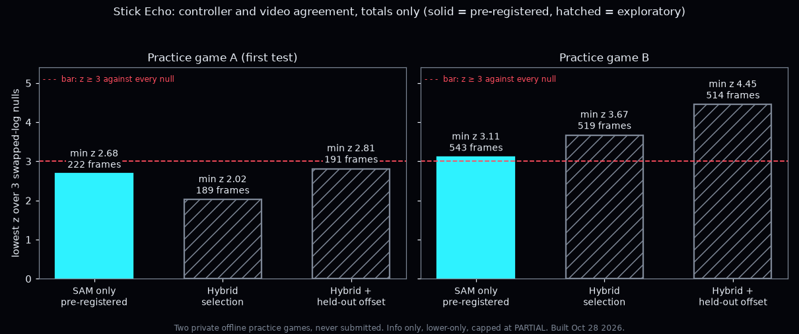

[← README](../README.md) · [Docs index](README.md)

# Stick Echo — SAM 3.1, info only, lower-only

> Built Oct 28 2026, during the hackathon week. A clear disagreement can at most lower VERIFIED → PARTIAL; nothing
> else. It never raises a status, never makes the call, and the live referee is not changed.

**The question:** does the on-screen player the gamer controls move the way the logged left stick says, one fixed
lag later? If the controller log and the video come from the same play, they should; if the log was swapped, replayed
or belongs to someone else's game, they should not. When they line up, the result reads **"controller and video
agree"**. That is all it says: it does not show who held the controller.

## How it works
1. **Lag, fixed first.** The press-to-screen lag comes from the same game's pause challenges
   ([Challenge Echo](CHALLENGE_ECHO.md), the median of the `consistent` clips). It is fixed before any scoring. A lag
   sweep is printed as a diagnostic only; picking its peak would be lag-shopping.
2. **Track (SAM 3.1).** Short windows (≤ 10 s, video only, no audio) of live play where the stick is active. SAM 3.1
   gets one box prompt on the body standing on the game's controlled-player marker (Madden NFL 27's neon hexagon),
   re-anchored every 2 s, and propagates it forward. Marker detection, the seed box, camera compensation (background
   homography) and everything after are deterministic code.
3. **Select frames (never using the stick).** `sam` uses every SAM frame; this is the pre-registered method.
   `hybrid` keeps SAM only where its player stands on the marker and moves with it; where SAM has drifted to another
   player it uses the marker's own motion; frames next to a control switch, or with neither source, are dropped.
4. **Score.** Per frame, the cosine between the player's motion and the stick direction one lag earlier (moving
   frames with the stick pushed only). The null scores the **same video motion** against stick timelines from other
   moments of the same game and from other games' logs (5000 draws). **Bar: z ≥ 3 against every null source.**
5. **Effect.** `stickecho.sidecar.json` (schema `qortime.stickecho.v0`, integers only, totals only, next to the
   receipt; `receipt.v0.json` is untouched). `agree` / `inconclusive` / `unscorable` (< 300 scored frames) add a note;
   `disagree` (z < 1 against every null) can suggest VERIFIED → PARTIAL and nothing else (`sidecar.py`, tests).

## Results on two private practice games (totals only)

Both games were offline practice games, never submitted to the referee. Video and controller logs stay private; only
totals are published. Game A is the first test, game B the second; the bar was set before game B was scored.

| Game | Method | Frames | Mean cosine | z vs same game / other game 1 / other game 2 | Status |
|---|---|---|---|---|---|
| A | `sam`, Echo lag (pre-registered) | 222 | 0.41 | 3.15 / 2.88 / 2.68 | below the bar (too few frames) |
| **B** | **`sam`, Echo lag (pre-registered)** | **543** | **0.58** | **3.87 / 3.56 / 3.11** | **meets the bar** |
| A | `hybrid`, Echo lag | 189 | 0.41 | 2.20 / 2.21 / 2.02 | exploratory |
| B | `hybrid`, Echo lag | 519 | 0.66 | 4.47 / 4.12 / 3.67 | exploratory |
| A | `hybrid`, + response offset from game B | 191 | 0.55 | 3.07 / 3.01 / 2.81 | exploratory |
| B | `hybrid`, + response offset from game A | 514 | 0.79 | 5.41 / 4.95 / 4.45 | exploratory |

**Exploratory means tuned after seeing results.** `hybrid` was designed after game B's results showed SAM leaving
the controlled player on small, far-away players. The response offset came from the lag sweeps: on both games,
movement agreement peaks 0.2–0.3 s after the pause-menu lag (players accelerate and turn; a menu highlight does not).
Each game's offset was taken from the **other** game only, but with two games this is still exploratory. Neither
change is the bar until it is fixed in advance and checked on a new game. A stricter selection rule written down
before the re-score (SAM within a tight distance of the marker) kept too few frames (139 and 39) and is not used.

## Clock sync (end to end)
- The controller log and the capture manifest share one clock. The pause challenges, spread across each game, give
  press-to-screen lags of 1436 / 1432 / 1424 ms (game B, at 0.6, 13 and 25 min) and 1636 / 1641 / 1627 ms
  (game A, at 0.5, 6 and 14 min): **at most 12–14 ms of drift over a game**, under half a frame.
- Video frame counts match the manifest (game A exactly; game B's manifest counts 24 fewer frames, all at the very end).
- The logs are monotonic with a ~5 ms median report gap. The capture manifest's own timestamps jitter by about 0.3 s
  (they are hash times, not frame times), so they are not used for alignment.

## Limits
- Two practice games from one player, one title (Madden NFL 27, PS5), one capture setup. Not a measured accuracy.
- Game A is below the bar. Game B meets it, and its weakest null (3.11) is just over the line.
- The marker detector is tuned to this title's controlled-player marker; new teams, stadiums or titles need checks.
- Pass windows depend on reading the receiver icons; few throws are clean catches, so they add little.
- Stick magnitude vs on-screen speed was tested and is not a consistent signal (none on game B; players mostly run at
  a set pace), so only direction is scored.
- It relies on SAM staying on the controlled player. Small, far-away players (defenders, kick coverage) are the weak
  spot; the exploratory `hybrid` selection is aimed at exactly that and is not yet the bar.

Cost: SAM 3.1, 1,359 frames over 10 windows across both games, ≈ $0.27; the re-score above made no new calls.
